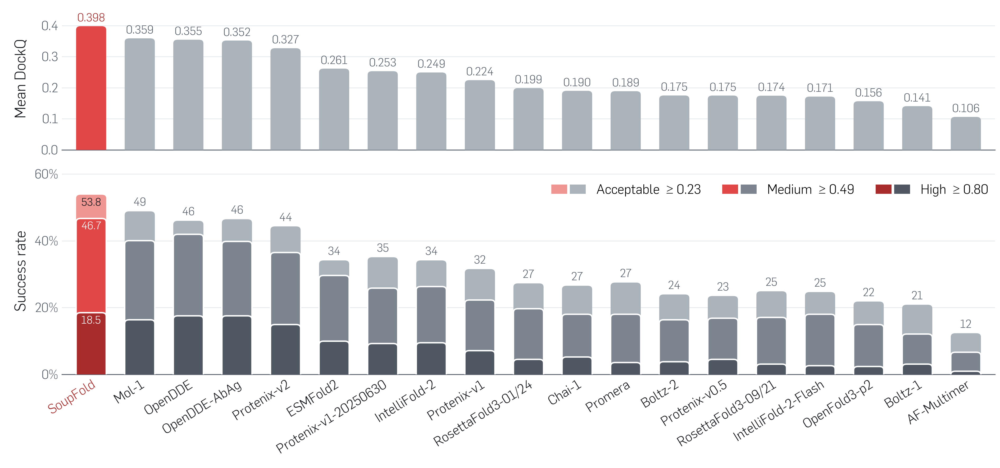

# SoupFold: one model, one checkpoint

[SoupFold](https://github.com/hsjang0/soupfold) as a single model: OpenDDE as the anchor, ESMFold2 and Protenix as peers. One
install, one checkpoint, one command. For the method and the full pipeline, see the [main branch](https://github.com/hsjang0/soupfold).

## Run

```bash
git clone -b soup-opendde-pack https://github.com/hsjang0/soupfold.git && cd soupfold
uv venv --python 3.12 && uv pip install -e .
.venv/bin/soupfold-pack --input examples/9mnb/9mnb.json
```

The first run downloads the [checkpoint](https://huggingface.co/hyosoon0/soup-opendde-pack) (18 GB) and the CCD data (0.7 GB) from
Hugging Face. Samples go to `soupfold_out/samples/soupfold/opendde/seed_1/`: `<system>__s<i>.cif` and `<system>__conf.json`.

The input is a Protenix-format JSON, as in the [main branch](https://github.com/hsjang0/soupfold#input). Template structures are read
from `mmcif/` next to it.

If a chain has one a3m (no separate paired file) with taxonomy in its headers (`key=<id>`, `TaxID=<id>` or `UniRef100_<acc>_<id>`),
ESMFold2 pairs by that taxonomy.

| option | |
|---|---|
| `--seeds 1-5` | seeds to run, default 1 |
| `--workdir <dir>` | output directory, default `soupfold_out` |
| `--chunk-thresholds '{"1024":64,"2048":16}'` | OpenDDE trunk chunk sizes by token count; the default fits an 80 GB GPU, smaller chunks use less memory |
| `--checkpoint`, `--protenix-root`, `--template-mmcif-dir` | use local files instead of the defaults |

## CoFold Arena



The 422 antibody-antigen targets of [CoFold Arena](https://cofoldarena.ai/). Other models show the official leaderboard scores with
MSA (site data of 2026-10-29). SoupFold is our own run of this branch, not a leaderboard entry: the site's MSAs with their taxonomy
headers converted, no templates, seed 1, scored with tinyprot under the site's identity chain mapping.

## License

The model code in `soupfold/models/` comes from Protenix, OpenDDE and esm, under Apache-2.0 and MIT
([`NOTICE`](soupfold/models/NOTICE.md), [`LICENSES/`](LICENSES)). The checkpoint's parts, sources and changes, including the Biohub
Acceptable Use Policy for ESMC-6B, are in its [`NOTICE.md`](https://huggingface.co/hyosoon0/soup-opendde-pack/blob/main/NOTICE.md). The
rest of SoupFold follows these licenses. AlphaFold3 is not used. To cite, see the
[main branch](https://github.com/hsjang0/soupfold#citation).
